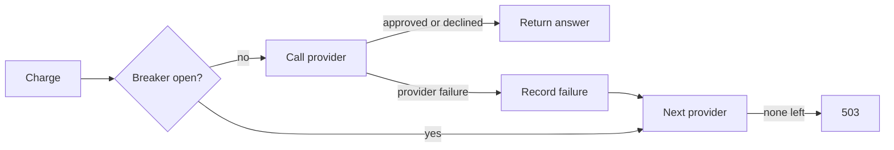

# provider-failover

Payment-provider failover driven by a sliding-window error rate, in Kotlin and Spring Boot. This is a small demonstration with simulated providers, not production code.

## How it works



## Decisions

- **A decline never fails over.** Declining is a valid answer. Retrying it elsewhere could charge a customer the issuer has refused.
- **The same idempotency key goes to every provider.** A timeout does not prove the first provider did nothing, so providers need the key to detect duplicates on their side. The key does not deduplicate across different providers, and that case needs reconciliation.
- **The error rate needs a minimum sample.** A single failure at low traffic should not remove a provider.
- **Recovery uses one probe.** After the cooldown, one request tests the provider, so a provider that is still down does not receive a burst of traffic.

## Run

Requires JDK 21+ and Maven.

```bash
mvn test
mvn spring-boot:run
curl -X POST localhost:8080/charges -H 'Idempotency-Key: order-1' -H 'Content-Type: application/json' -d '{"amountCents":1000}'
```

The state lives in memory per instance, so several instances would each keep their own view of provider health.
